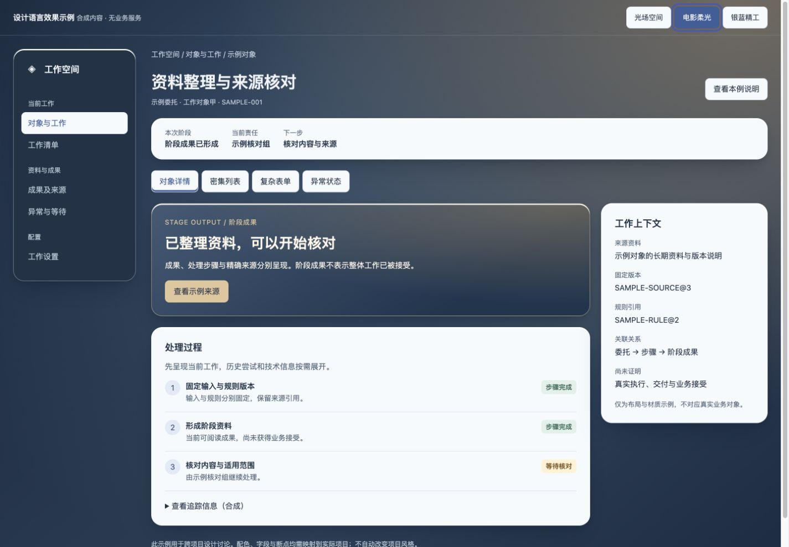

# 电影柔光 / Cinematic Softlight

## 视觉表述与关键词

蓝灰远景托起明亮工作面，少量琥珀暖光从一侧进入。以冷暖、前后景和明暗分工产生电影画面的安静纵深，避免把业务系统做成持续发光的监控大屏。

关键词：蓝灰远景、琥珀侧光、冷暖纵深、柔和轮廓、明亮工作面、聚焦。适合品牌辨识较强的工作台、重点详情与成果阅读；长时间录入或高密度业务应观察暗环境切换浅正文的疲劳感，必要时减小亮度落差。

## 构图、色彩与材质

- 暗环境/导航与浅色正文分开定义文字角色。环境字 #d5e1ee，环境次字 #c4d1de；工作面字 #26394f、次字 #596e84。不要让深色正文变量直接作用于暗环境中的标题、加载、错误、空态或提示。
- 起步角色：canvas #24354d、surface #f8fbfd、accent #4b68a4、line #dfe6ed；暖光 #d8b683。深色成果焦点可用 #243d59，文字 #fff9ef，动作暖白底/深字；不是所有按钮都用金色。
- 容器20px、控件8px；顶部单向柔光和低频渐变即可。环境可暗，字段、表格与校验保持实色浅底。结果焦点的对比变化只强调真实内容，不能表达未经证实的“成功”。
- 阴影方向与光源一致，暗导航不靠黑色粗边框分隔；内容标题与版式沿项目角色，不引入电影字幕字体或全大写正文。

## 布局与接入

用[工作区布局](workspace-layouts.md)保持导航退后、主工作面前置。详情可用深色结果焦点+浅色过程区，但结果缺失时显示真实等待/失败，不造占位成果。列表和表单仍用连续浅色工作面，不将每行改成暗卡。

[效果示例](../../assets/design-language-demo/index.html#cinematic)及[CSS](../../assets/design-language-demo/languages.css)包含环境/正文双套文字Token。以 `.ql-demo[data-language="cinematic"]` 为起点映射到项目；重用原状态和操作，不从示例生成业务接口。

## 正反例与检查

正例：琥珀光只出现在环境与一个焦点，暗背景文字明确，正文及错误稳定。反例：暗环境继承深字；暖金用于所有边框；纯装饰光效被读为等待、报警或完成。

检查加载瞬间、空/失败/未知/受限、悬浮提示及浮层是否在正确表面使用正确字色，不能只验最终成功页。检查窄屏首个任务是否可见、低透明度模式和减少动态效果；主工作面与背景切换不能造成文本消失。

## 来源与参考边界

布局借鉴[Linear的内容优先](https://linear.app/now/behind-the-latest-design-refresh)与[Carbon网格](https://www.carbondesignsystem.com/building-blocks/foundations/2x-grid/overview)，功能层次参考[Apple的空间材质说明](https://www.apple.com/newsroom/2025/06/apple-introduces-a-delightful-and-elegant-new-software-design/)。蓝灰/琥珀的电影式配光为本语言自创演绎；没有特定电影剧照来源，不声称上述品牌采用此主题，也不附带影视素材授权。

同内容浏览器效果（合成示例，非业务验收）：

