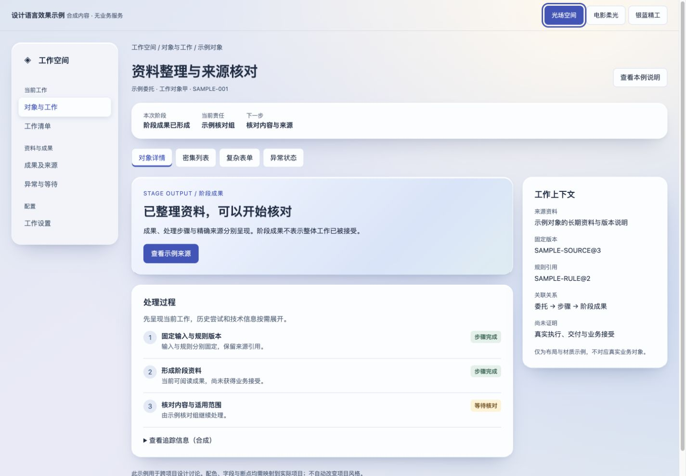

# 光场空间 / Lightfield Space

## 视觉表述与关键词

在冷白、淡蓝与低饱和紫青构成的环境中，用单向柔光、悬浮导航和稳定工作面表现空间；色彩有变化，正文仍是视觉中心。

关键词：通透空间、柔和光场、珍珠白、冷暖平衡、分层悬浮、连续工作面。适合综合工作台、对象详情、需要长时间阅读的管理系统；密集扫描采用紧凑密度，保留环境而收敛内层阴影。不是全站默认风格。

## 构图、色彩与材质

- 空间分三层：低频环境渐变→导航/工作面→菜单/对话框。主工作面为实色，辅助表面可以接近不透明；每个字段或每行记录不再单独悬浮。
- 单一主光从右上进入，阴影向下；珍珠白高光只用于容器上缘。低饱和紫蓝作交互强调，青色仅为环境辅光，暖白作局部入光，不把多色渐变用于正文或状态文字。
- 起步角色：canvas #e8eef8、surface #fcfdff、ink #23334e、muted #5d6e86、accent #535fc4、line #dce4f0。容器半径20px、控件8px；紧凑表面可收至12px。准确值见[可运行CSS](../../assets/design-language-demo/languages.css)，映射项目Token后再采用。
- 正文14–16px，标题28–34px按目标视口收敛；字段标签和状态保持可读。多彩来自少量有分工的角色，不用每张卡一种颜色。

## 布局与接入

沿[工作区布局](workspace-layouts.md)按任务选择：详情用主工作面+上下文；密集列表用全宽连续表格；复杂表单用连续章节。状态摘要以“对象/当前事实/下一责任方”组织，不用装饰KPI替代。结果可成为主焦点，执行过程和追溯按层展开，真实异常不能藏起。

[效果示例](../../assets/design-language-demo/index.html#lightfield)：与其他两种语言保持同一内容和布局。CSS挂在 `.ql-demo[data-language="lightfield"]`；在实际项目适配选择器和Token，不复制示例对象、业务状态或链接。

## 正反例与检查

正例：导航与环境有光感，表格/字段/错误坐落实色表面，主工作区比上下文更强。反例：所有卡片发光、文字透底、为营造空间放大空白到看不到当前任务。

实际检查宽窄布局、长标识、弹层、错误与焦点；关闭模糊/动画后仍可读。状态色独立于材质角色。共享CSS中的数值是可执行起步样例，不能代替项目对比度和性能验证。

## 来源与参考边界

- [Apple新设计与Liquid Glass](https://www.apple.com/newsroom/2025/06/apple-introduces-a-delightful-and-elegant-new-software-design/)：借鉴功能层与内容层的空间关系，不复刻原生折射或使用品牌素材。
- [Linear界面组织](https://linear.app/now/behind-the-latest-design-refresh)：借鉴导航退后、工作内容优先及操作位置一致。
- [IBM Carbon 2x Grid](https://www.carbondesignsystem.com/building-blocks/foundations/2x-grid/overview)：借鉴网格与排版节奏，不要求采用Carbon框架。

光场配色、阴影组合与网页实现为本语言的独立演绎，非上述产品官方主题。

同内容浏览器效果（合成示例，非业务验收）：

