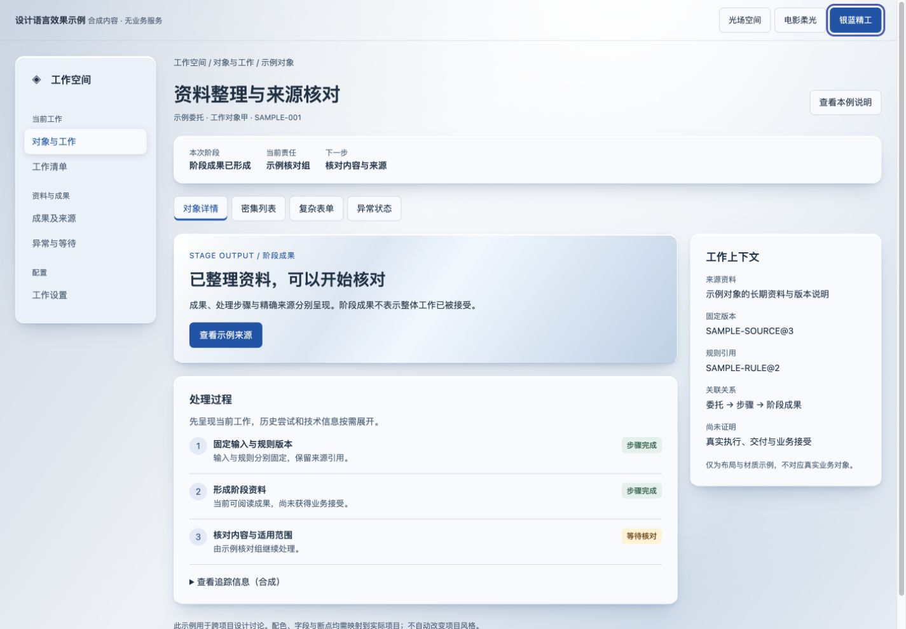

# 银蓝精工 / Silver Blue Precision

## 视觉表述与关键词

以冷白、浅银和冰蓝构成清晰工作面，用细微亮边、低幅反射与较紧几何表现精密和现代感。空间来自面与面的距离及边缘质量，避免机械拟物按钮或大面积镀铬。

关键词：冷白银灰、冰蓝精工、精细边缘、克制反射、稳定网格、清晰秩序。适合综合管理、工具目录、工程运营和密集数据工作；品牌暖色项目可适配角色而非照搬蓝色。

## 构图、色彩与材质

- 起步角色：canvas #dfe6ee、surface #f9fbfe、ink #21384f、muted #536a81、accent #245eb2、line #d6e0ea。较深蓝只用于主动作/选中，银色只表示表面，不作为禁用或未完成的独立含义。
- 容器半径14px、控件7px、表格8px。上缘浅高光、下缘较深细边和收敛阴影形成精度；不向每个单元格追加高光或阴影。
- 表格头可用 #e7eff8，正文实色；长标识可换行，数值按比较任务对齐。采用项目原字体，不以极细字或小字表达精密。
- 错误、警告、未知、受限仍用独立语义。材质控件边框不能覆盖 aria-invalid 的错误边框；焦点轮廓不与蓝色选中填充混为一体。

## 布局与接入

按[工作区布局](workspace-layouts.md)选择结构：详情主次分栏；高密度列表放大工作宽度而不是增加卡片间距；表单按章节成组。在窄屏优先保留对象、状态、主要动作及完整值入口，不能为了整齐裁掉版本。

[效果示例](../../assets/design-language-demo/index.html#alloy)与[CSS](../../assets/design-language-demo/languages.css)可直接离线打开；样例 `.ql-demo[data-language="alloy"]` 只提供视觉角色，不预设业务。

## 正反例与检查

正例：银白表面、清楚基线和克制蓝色动作，在紧凑密度下仍清晰。反例：所有按钮像金属凸起；蓝色装饰取代异常色；以大量1px线把每个字段框成盒子。

检查长列表扫描、字段校验、选中/焦点/禁用的区分及窄屏滚动；尤其验证错误样式在主题样式之后仍有效。材质降级后应保留信息层级，不依赖动画或模糊。

## 来源与参考边界

[Carbon 2x Grid](https://www.carbondesignsystem.com/building-blocks/foundations/2x-grid/overview)提供几何节奏和密集内容组织参考；[Linear界面组织](https://linear.app/now/behind-the-latest-design-refresh)提供层级与一致操作参考。精细边缘和冷白银蓝配方为自创网页演绎，不是IBM/Linear官方主题，不要求引入其库或素材。

同内容浏览器效果（合成示例，非业务验收）：

