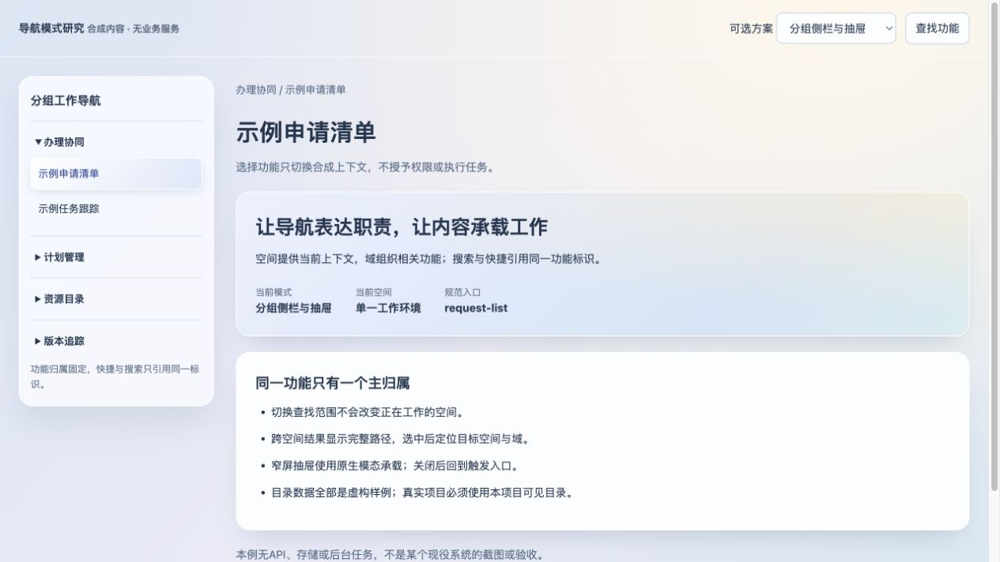

# 分组侧栏与抽屉 / Grouped Drawer

适用：一个工作环境下的若干任务分区，尚不需要独立职责空间。适合综合工作台、中等规模后台。结构关系是任务分组→功能入口，不把分组当权限角色。

## 布局与交互

- 宽屏：带文字侧栏，当前功能所在组可见，其他组按需折叠；标识/搜索/工具区稳定，长菜单只在内容区纵向滚动。当前项使用准确aria-current，分组展开状态可读。
- 窄屏：顶栏菜单按钮打开侧滑抽屉，不将整组导航铺在顶部横滚，也不把长层级塞进普通select。菜单很多时允许抽屉内容纵滚，搜索和关闭可达，正文不因打开菜单被推到页尾。
- 抽屉若为模态，优先复用项目已有Dialog/Sheet。进入后焦点在内部、Tab/Shift+Tab约束、Escape/关闭/遮罩按组件契约关闭、背景不可交互和滚动，关闭回合理触发位置。跨断点/路由/模式切换释放模态状态。行内非模态展开与模态不能混称。
- 搜索从当前可见目录按名称/别名/分组匹配，结果显示路径；空结果有明确反馈。常用是原功能ID的快捷引用，不复制路由、业务归属或权限。偏好持久化的身份/租户/环境边界沿项目合同；保存偏好不等于缓存授权目录。
- 原方案可按用户要求保留切换比较，但不要为比较器挤压日常工作。旧模式缺陷不得作为新默认模式通过的证据。

## 接入与观察

用项目现有导航宿主维护目录与控制器，不在每个业务页复制。当前页、详情子页和回链要落到同一主入口。若宿主只提供静态可见菜单，明确该边界，不声称已实现服务端权限过滤。

CSS中显式核对抽屉关闭/hidden、移动端display、flex/grid的align-items、遮罩层级和独立滚动区域。全局button/display规则可能覆盖hidden的UA默认样式，旧页面局部布局也可能挤窄公共抽屉；遇到此类冲突修共享拥有者的局部作用域，不靠隐藏正文遮掩。

实测：关闭时遮罩确实不可见且不拦点击；打开时背景inert/焦点不逃逸；选择入口后导航关闭且当前项正确；原模式往返、搜索空/非空、常用增删/刷新、跨断点关闭、长名与内容区无整页横溢。仅查aria属性不等于交互通过，不能仅有遮罩就称模态完成。

本模式可从已验证的同类实现复用方法，样例不是项目代码库或业务API。[效果例](../../assets/navigation-pattern-demo/index.html)。参考：[Carbon侧栏](https://www.carbondesignsystem.com/building-blocks/core/components/ui-shell-left-panel/accessibility)、[W3C模态](https://www.w3.org/WAI/ARIA/apg/patterns/dialog-modal/)、[Atlassian侧栏与常用](https://support.atlassian.com/navigation/docs/navigation-best-practices/)。

